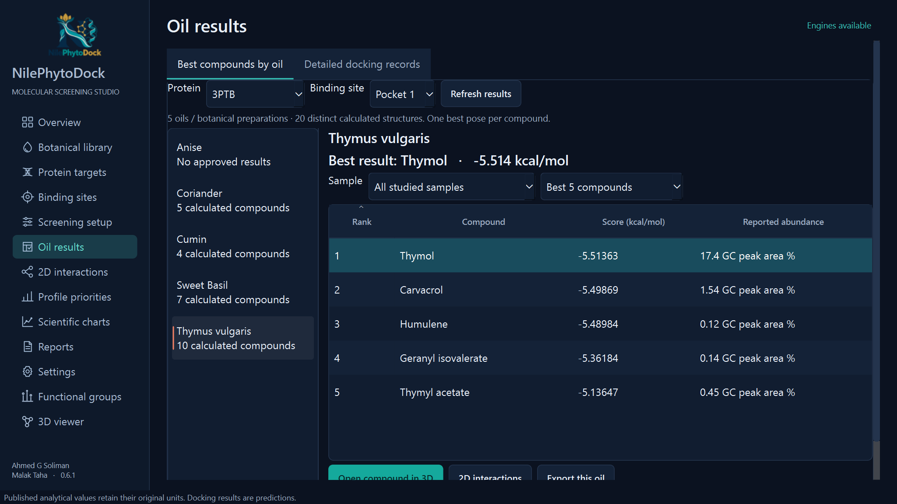
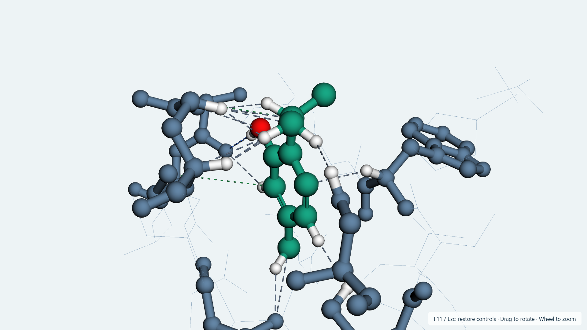
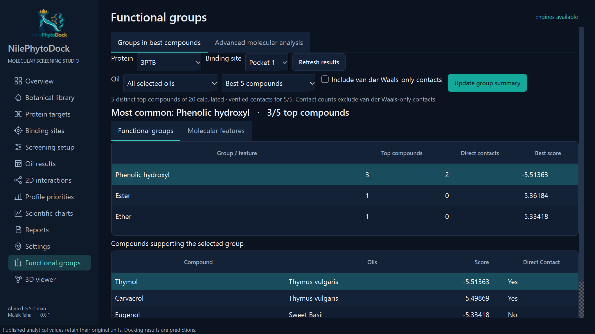

# NilePhytoDock 0.6.1 — Results and 3D guide

Developers: Ahmed G Soliman and Malak Taha.

This external English guide supersedes the result-page and split-view instructions in the retained 0.6.0 manuals. The scientific preparation, docking, source-data and benchmark methods remain unchanged.

## Best compounds in each oil

1. Open a completed study from Overview, or finish a new screening.
2. Open **Oil results**. Choose the protein and binding site. When different docking protocols exist, select one protocol; their scores are never mixed.
3. Choose an oil from the left. The main table shows its best five compounds, ordered by the lowest saved docking score. Choose three, ten or all calculated compounds if needed.
4. Read the compound name, score in kcal/mol and its reported abundance. The **Sample** selector separates analytical samples. Multiple source observations remain separate; percentages are not averaged, added or normalized.
5. Double-click a compound, or click **Open compound in 3D**. Its actual saved pose opens directly in an independent maximized window. **2D interactions** opens the separate diagram page.
6. **Export this oil** writes the displayed compounds and their individual source observations to CSV, XLSX and DOCX. Full docking records remain in the secondary **Detailed docking records** tab.

Each structure counts once per oil, protein, site and protocol, even if aliases or multiple docking poses exist. Shared compounds can appear in several oils without being counted repeatedly in the overall chemical population. Observations must belong to selected study samples and be eligible for native-molecule docking. Oils without approved saved constituents remain visible with an explicit empty state. Abundance does not determine the docking order.

## Independent 3D window

The 3D view has its own navigation page and its own maximized window. No result table or 2D canvas shares that window.

- **F11** or **Full screen** uses the screen for the molecular canvas. **Esc** restores controls; Esc again closes the separate window.
- Drag to rotate, use the wheel to zoom and right-drag to pan.
- **Ligand focus** displays the ligand and binding residues clearly against a thin protein context. **Protein overview** fits the entire protein in cartoon form.
- Expand the rendering sections to change representation, colors, surfaces, labels and interaction filters. **Export PNG** saves the actual molecular view.
- These are camera and display changes. Saved docking coordinates and measured interaction geometry are unchanged.

## Functional groups in the best compounds

1. Open **Functional groups** and choose the same protein and binding site.
2. Choose all selected oils or one oil, then the best five, ten, twenty or all calculated compounds. Ties at the score cutoff are retained.
3. **Most common** identifies the conventional functional group or tied groups occurring in the largest number of these top compounds.
4. **Top compounds** counts distinct structures containing that group. **Direct contacts** separately counts structures whose group atoms participate in verified protein contacts. Van der Waals-only contacts are excluded by default; an explicit checkbox includes them.
5. Select a group to see its supporting compounds, oils, scores and contact status. Hover a compound for contact categories and residues. Open a supporting compound directly in 3D or export the summary and underlying records.

Aromatic rings, alkenes and hydrophobic atom features are shown separately under **Molecular features**. A frequent group is not necessarily contacting the receptor, and a contacting group is not demonstrated to cause affinity. The display reports predicted associations within the selected cohort, not experimental activity or whole-oil efficacy. Unavailable contact analyses are reported explicitly. **Advanced molecular analysis** retains the independent similarity, cluster and exploratory statistics tools.

## Download and launch

The repository is public: [GitHub releases](https://github.com/ahmedGSoliman99/NilePhytoDock/releases). GitHub login is not required. Extract the complete Windows x64 ZIP, retain `_internal` beside `NilePhytoDock.exe`, and launch the 0.6.1 executable. Older releases remain separate. `Create Shortcuts.ps1` creates a versioned shortcut for the extracted location.
